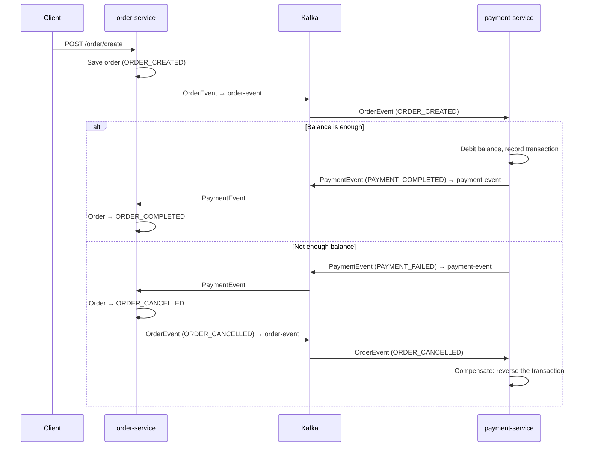

# Spring Boot SAGA (Choreography)

A distributed transaction across two microservices using the **Saga pattern (choreography)**.
There is no central orchestrator: each service reacts to events on Kafka and publishes its own,
and a failed payment triggers a **compensating action** that cancels the order.

## Tech stack

- Java 17, Spring Boot 3.1
- Spring Cloud Stream (functional style) with the Kafka binder
- Project Reactor (`Sinks`, `Flux`) for publishing events
- Spring Data JPA + MySQL
- Maven multi-module build

## Modules

| Module | Port | Responsibility |
|---|---|---|
| `order-service` | 8081 | Accepts orders over REST, publishes `OrderEvent`s, updates order status from `PaymentEvent`s |
| `payment-service` | 8082 | Checks the user's balance, debits it and publishes `PaymentEvent`s; reverses the transaction when an order is cancelled |
| `common-dtos` | – | Shared DTOs, events and status enums used by both services |

## How the saga flows



| Topic | Producer | Consumer |
|---|---|---|
| `order-event` | `order-service` (`orderSupplier`) | `payment-service` (`paymentProcessor`) |
| `payment-event` | `payment-service` (`paymentProcessor`) | `order-service` (`paymentEventConsumer`) |

## Running locally

**Prerequisites:** JDK 17, Maven, a local Kafka broker on `localhost:9092`, and MySQL on `localhost:3306`
with a database named `saga` (user `root`, empty password — change it in each service's
`application.properties`).

```bash
# build all modules
mvn clean install

# in two terminals
mvn -pl order-service spring-boot:run
mvn -pl payment-service spring-boot:run
```

On startup, `payment-service` seeds balances for users **101–105** (e.g. user `105` has only 999),
so you can try both the happy path and the compensation path.

### Try it

```bash
# succeeds: user 101 has a balance of 5000
curl -X POST http://localhost:8081/order/create \
  -H "Content-Type: application/json" \
  -d '{"userId":101,"productId":1,"amount":1500}'

# fails and is compensated: user 105 has only 999
curl -X POST http://localhost:8081/order/create \
  -H "Content-Type: application/json" \
  -d '{"userId":105,"productId":2,"amount":2000}'

# check the final status of each order
curl http://localhost:8081/order
```

## What I'd improve next

- **Transactional outbox** so saving the order and publishing the event can't get out of sync
- **Idempotent consumers** so a redelivered event can't debit a user twice
- **A database per service** instead of the shared `saga` schema
- **Docker Compose** for Kafka and MySQL, and integration tests with Testcontainers
